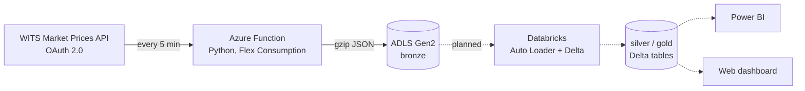

# NZ Electricity Market Data Pipeline

An end-to-end data engineering project that collects New Zealand wholesale electricity prices in near real time and turns them into analysis-ready data on Azure.

The pipeline pulls 5-minute dispatch prices for every grid node from the official WITS Market Prices API, lands them in an Azure Data Lake, and will (planned) transform them with Databricks into tables for Power BI and a web dashboard.

> **Status:** Ingestion layer is live on Azure, collecting continuously every 5 minutes since 1 Nov 2026. Databricks transformation and dashboards are planned and not started yet (see [Roadmap](#roadmap)).

---

## Why this project

New Zealand runs a nodal electricity market: every grid connection point has its own price, updated every few minutes. Prices are shaped by hydro storage, North–South transmission limits and peak demand, so the data is a good fit for both engineering (high-frequency, revised over time, time-zone and daylight-saving edge cases) and analysis (regional price gaps, renewable share, peak vs off-peak).

Example from the first data pull (19 Oct 2026, 21:25 NZDT):

| Node | Location | Price (NZD/MWh) |
|---|---|---|
| BEN2201 | Benmore, South Island (hydro hub) | 33.34 |
| OTA2201 | Otahuhu, Auckland (load centre) | 109.06 |

---

## Architecture



Solid lines are live; dotted lines are planned.

| Layer | Technology | Status |
|---|---|---|
| Source | WITS Market Prices API (NZX, on behalf of the Electricity Authority) | Live |
| Ingestion | Azure Functions (Python, timer trigger, Flex Consumption plan) | Live |
| Storage | Azure Data Lake Storage Gen2 (hierarchical namespace) | Live |
| Transformation | Azure Databricks, PySpark, Auto Loader, Delta Lake, Unity Catalog | Planned |
| Serving | Power BI, web front end | Planned |

---

## Data source

- **API:** WITS Market Prices API (`/api/market-prices/v1`), authenticated with OAuth 2.0 client credentials
- **Schedule collected:** `RTD` (real-time dispatch), energy market (`marketType=E`), all nodes
- **Grain:** one price per node per dispatch interval, on 5-minute boundaries; not every 5-minute slot is present (see [Observed data quality](#observed-data-quality))
- **Volume:** 246 nodes; ~3,400 records per run (median), ranging from about 500 to 4,400 depending on how many intervals the API returns
- **Window:** the API only serves a rolling window of about ±7 trading periods, so data must be collected continuously or it is lost

Key fields:

| Field | Meaning |
|---|---|
| `tradingDateTime` | Dispatch interval start, NZ local time with UTC offset |
| `tradingPeriod` | Half-hour period of the day, 1–48 (46 or 50 on daylight-saving change days) |
| `node` | Grid connection point, e.g. `BEN2201` = Benmore, 220 kV, bus 1 |
| `price` | NZD/MWh |
| `lastRunTime` | When the price was calculated (~1 minute latency observed) |

More detail in [`docs/data_notes.md`](docs/data_notes.md).

### Observed data quality

A full scan of the bronze layer (1 Nov 00:20 UTC to 4 Nov 22:30 UTC, 2026) found:

| Check | Result |
|---|---|
| Ingestion runs | 1,131, none skipped, none empty |
| Nodes per interval | 246 in every interval present |
| 5-minute slots | 76 of 1,130 missing (6.7%), longest run 13 slots (about 1 hour) |
| Newest interval lag | Usually under 10 minutes, peak 65 minutes |
| Prices changed between runs | 0.73% of `(node, interval)` keys |

Missing slots stayed missing in later overlapping runs, so they were not returned by the API rather than lost by a failed run. The cause is not yet confirmed. Runs kept succeeding during the stale periods, so monitoring needs to check data freshness as well as Function failures.

---

## Design decisions

**Overlapping collection window.** Each run requests the current and previous 2 trading periods (`back=2`), so consecutive runs overlap. A delayed or failed run loses nothing as long as the outage is shorter than about an hour; a longer outage can lose data permanently from the RTD feed. Duplicates will be removed in the silver layer by key `(schedule, node, tradingDateTime)`, keeping the latest version of each key, because prices can change between runs.

**Raw data kept untouched.** The bronze layer stores the API response as returned, wrapped with ingestion metadata (`ingestedAt`, `recordCount`, source), so any downstream logic can be re-run from source.

**Partitioned, compressed files.** Files are written as
`bronze/wits/rtd/date=YYYY-MM-DD/rtd_E_YYYYMMDDTHHMMSSZ.json.gz`.
The `date=` folder is picked up as a partition column by Spark, and gzip keeps each file at ~25 KB.

**Explicit time-zone handling.** Ingestion timestamps, folder dates and file names are UTC. Price timestamps keep the source NZ offset (+13:00 NZDT / +12:00 NZST). The NZ trading date is derived from `tradingDateTime`, never from the UTC folder name.

**Resilience.** HTTP calls retry with exponential backoff on 429/5xx; the API's 10,000-record page limit is handled with offset pagination.

**Separation of concerns in storage.** The Function App's own runtime storage (timers, keys, deployment package) is a separate account from the data lake, which only holds business data.

**Secrets out of code.** Credentials live in `.env` / `local.settings.json` locally (both git-ignored) and in Function App settings in Azure. Planned: move to Key Vault and managed identity.

---

## Cost

Built on an Azure for Students subscription, so cost was a design constraint.

| Item | Estimate |
|---|---|
| Storage volume | ~25 KB × 288 files/day ≈ 7 MB/day ≈ 210 MB/month (~2.5 GB/year) |
| Storage cost | ADLS Hot tier (LRS): well under US$0.01/month initially, cents/month after a year |
| Write operations | ~8,600 uploads/month: cents |
| Compute | ~8,600 short executions/month on Flex Consumption: expected within the monthly free grant |

Choices made to keep cost low: LRS instead of ZRS (raw data can be re-collected), gzip compression, smallest Function instance size. Planned: lifecycle policy to move older raw files to the Cool tier.

---

## Repository structure

```
nz-electricity-pipeline/
├── ingestion/                      # Azure Function (deployed)
│   ├── function_app.py             # timer-triggered ingestion
│   ├── host.json
│   ├── requirements.txt
│   └── local.settings.example.json # template for local settings
├── docs/
│   └── data_notes.md               # API fields, time zones, observations
├── fetch_wits_prices.py            # standalone script used to explore the API
└── README.md
```

---

## Running locally

Prerequisites: Python 3.10+, [Azure Functions Core Tools v4](https://learn.microsoft.com/azure/azure-functions/functions-run-local), a WITS developer account with the Pricing API enabled, and an Azure storage account.

```bash
cd ingestion
python -m venv .venv
.venv\Scripts\activate          # Windows; use `source .venv/bin/activate` on macOS/Linux
pip install -r requirements.txt

cp local.settings.example.json local.settings.json
# fill in storage connection string and WITS client id/secret

func start
```

To trigger a run immediately instead of waiting for the next 5-minute mark:

```bash
curl -X POST http://localhost:7071/admin/functions/ingest_wits_prices \
     -H "Content-Type: application/json" -d "{}"
```

---

## Roadmap

- [x] Explore WITS API and document fields
- [x] Serverless ingestion to ADLS Gen2 every 5 minutes
- [ ] Databricks workspace with Unity Catalog and secure access to the lake (managed identity)
- [ ] Silver layer: Auto Loader → flattened Delta table, de-duplicated to the latest version per key, with UTC and NZ timestamps
- [ ] Gold layer: island-level prices, North–South spread, peak vs off-peak, daily summaries
- [ ] Ingest Interim/Final prices and upsert revised prices (RTD → Interim → Final)
- [ ] Historical backfill from Electricity Authority EMI datasets
- [ ] Power BI report and near real-time web dashboard
- [ ] Data quality checks, monitoring and alerting, including a data freshness alert
- [ ] Infrastructure as code and CI/CD (Bicep/Terraform, Databricks Asset Bundles, GitHub Actions)

---

## Data attribution

Wholesale price data from the WITS Market Prices API, operated by NZX as WITS manager for the Electricity Authority Te Mana Hiko. This project is independent and not affiliated with either organisation.

## License

[MIT](LICENSE)